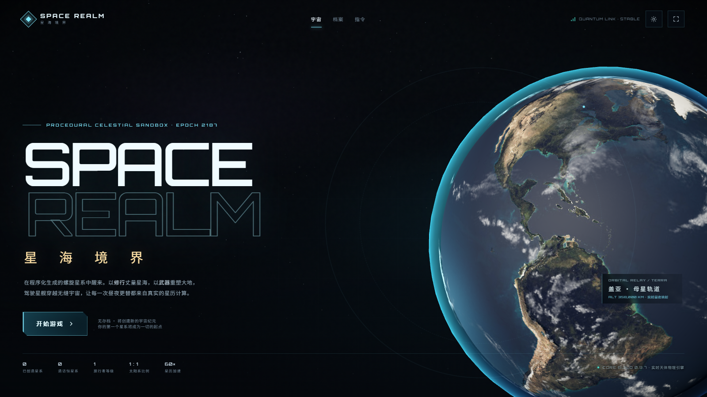
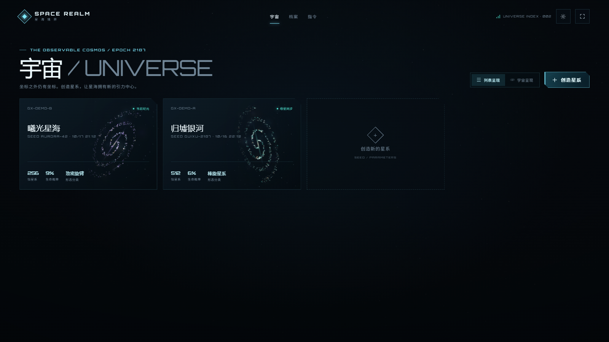
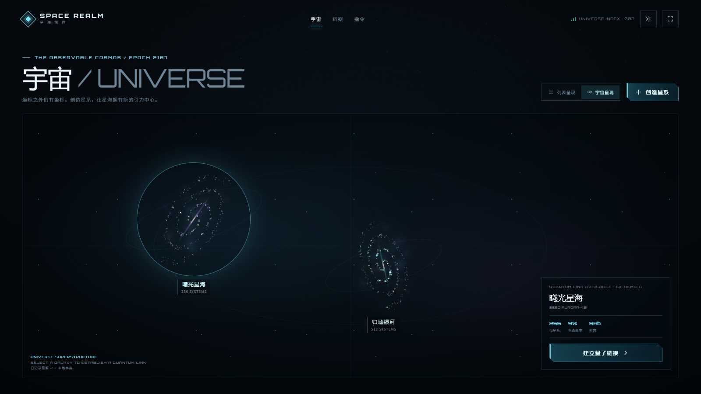
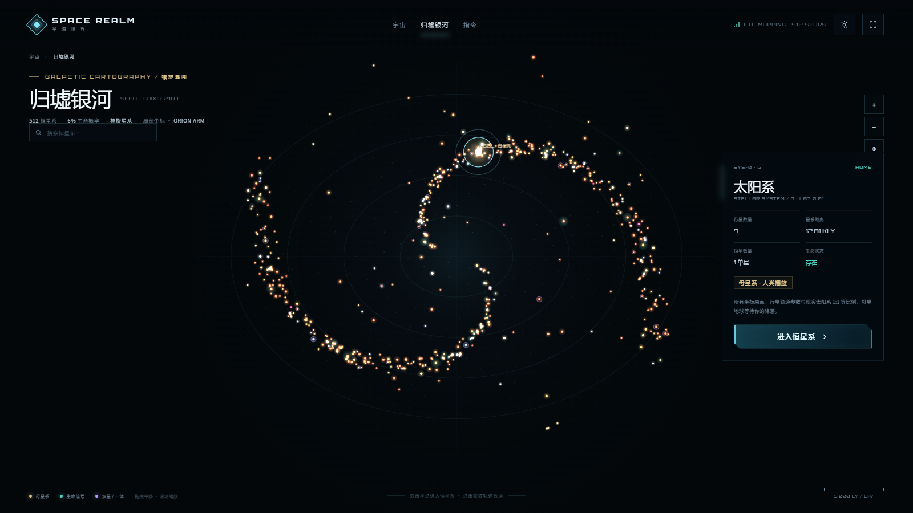
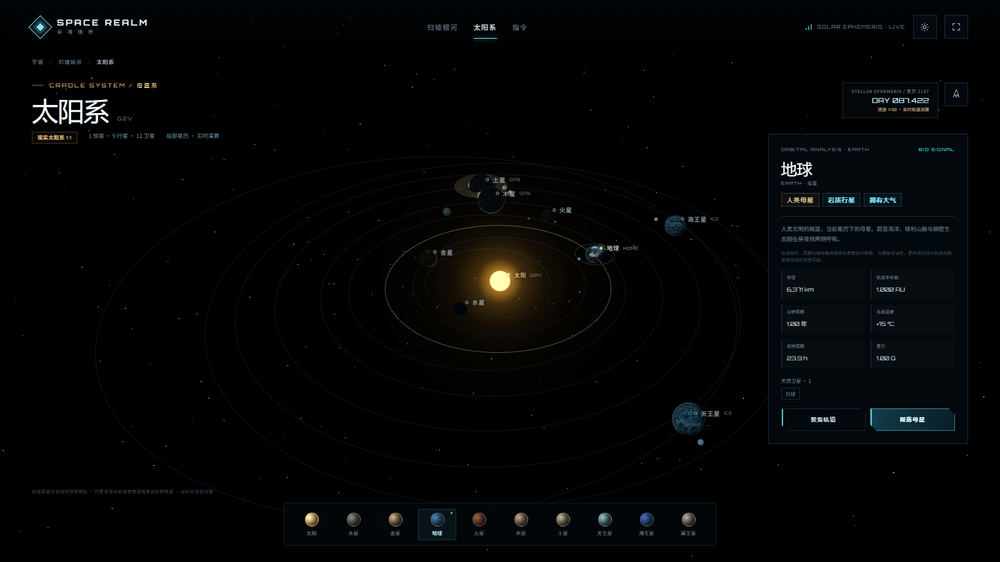
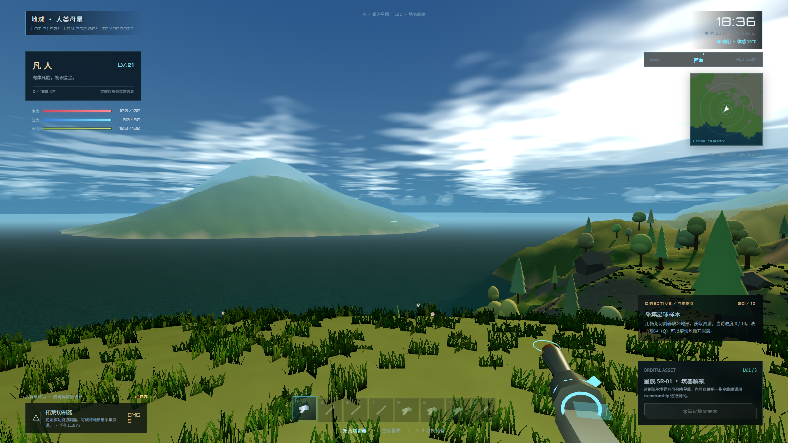
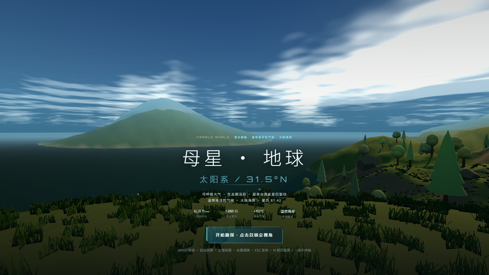

# SPACE REALM · 星海境界

一个可直接在浏览器运行的科幻星际沙盒游戏。程序化螺旋星图、1:1 比例太阳系、可自由破坏的体积地形、地道开挖、境界修炼、生存/造物双模式、动态天气与实时天象、无缝地表—轨道—星舰流程，全部由 WebGL 与原生 JavaScript 实时生成。



## 画面预览

| | |
| --- | --- |
|  |  |
|  |  |
|  |  |

`docs/screenshots/commands.png` 展示了游戏内指令终端。

## 运行

```bash
npm install
npm run dev
# http://127.0.0.1:5186
```

生产构建：

```bash
npm run build
npm run preview
```

推荐使用桌面版 Chrome / Edge，开启硬件加速。首次进入需在主页点击「开始游戏 → 创造星系」。

## 主要特性

- **宇宙索引**：初始为空的「宇宙」页，支持列表和宇宙星空两种呈现方式。创造星系时可输入/随机种子、指定 1–1024 个恒星系、1%–10% 生命行星概率。星系只保存配置，恒星与行星按需生成。
- **初次进入**：每次首次进入一个星系，导航协议会把旅行者直接同步到该星系母星的地表；后续进入才打开螺旋星图。地表按 `M` 随时打开银河星图，按 `Esc` 打开地表终端并返回轨道。
- **螺旋星图**：可拖拽、缩放、搜索的 2D 星图，包含恒星光谱、双星/三体稀有系统、生命信号与母星系标记。双击星点或选中后进入恒星系。
- **1:1 母星系**：首次进入的母星系使用真实太阳系数据——水星到海王星（以及冥王星）的半径、轨道半长轴、离心率、公转/自转周期、轴倾角、主要卫星与现实一致；行星位置由开普勒方程实时求解。恒星系视图在视觉映射上强制展开相邻轨道，行星不会互相重叠。
- **实时天象**：地表太阳、月亮、其他行星与其他恒星的方位来自同一套星历与行星自转/轴倾角矩阵；昼夜线、月相、恒星高度、当地时刻均与恒星系视图共享同一模拟时钟。天空包含体积云、星空、银河带和天气。
- **自由地形破坏**：近场地形是真正的三维 SDF 场，采用 Marching Cubes 生成网格。挖掘不是降低高度图，而是对球状空间做布尔减运算，因此可以挖洞、形成悬垂、互相连通的地道；右键凝铸可以抬高/补回地形。地形改动按行星持久化保存。
- **程序化生态**：九种气候/生物群系调色、海岸线、山脊、雪线、森林、草地、灌木、花朵、岩石、海洋与游荡生物；大气雾、太阳阴影、昼夜光照。挖掘会同步清除失去地面支撑的草、树、灌木、花朵与岩石，不会出现悬空植被。
- **境界修炼**：13 个大境界、指数级修为需求与指数级破坏力倍率；采掘、采伐、击杀、首次着陆、首次采样、合成均可获得修为。
- **生存 / 造物模式**：生存模式有有限生命/法力/体力，法力必须通过星髓晶资源或浓缩液恢复，体力在移动、疾跑和跳跃时消耗并持续恢复；造物模式无伤、法力无限、体力常满。
- **工具与合成**：类 Minecraft 的资源合成链，从石镐到等离子掘进器、脉冲步枪、星陨长剑、湮灭炮。破坏力通过武器结算。
- **星舰**：达到筑基（LV.8）后按 `V` 召唤，星舰以程序化网格建模（无外部模型），穿过云层降落。靠近后按 `E` 登舰升空；升空使用过场与遮罩过渡，不出现加载页面，随后进入恒星系自由飞行与曲率跃迁。飞行中 `J` 跃迁、`L` 着陆。
- **太空行星**：轨道视图中的母星使用 NASA 地球日面/夜晚灯光/云层贴图；有生态的行星才有云层，无生命星球不生成云层，只保留地貌、大气边缘、环系与尘埃/火山灰等非云天气。从太空可以看到云层与地貌/夜灯，太阳方向决定昼夜明暗面。
- **指令系统**：56 条指令，涵盖传送、天气、时间、地形、物品、模式、星舰、星图、存档与调试。完整文档在 [`docs/COMMANDS.md`](docs/COMMANDS.md)，游戏内输入 `/help` 或反引号打开终端。

## 操作

| 按键 | 功能 |
| --- | --- |
| `WASD` | 移动 |
| 鼠标 | 视角（点击画面锁定指针） |
| `Space` / `Shift` | 跳跃 / 疾跑；飞行时上升 / 加速 |
| 左键 / 右键 | 采掘、攻击 / 凝铸地形 |
| `Q` | 灵能脉冲（消耗法力） |
| `E` | 交互 / 登舰 |
| `V` | 召唤星舰 / 退出星舰驾驶 |
| `M` | 打开银河星图 |
| `C` / `K` / `Tab` | 合成 / 修炼 / 背包 |
| `F` | 反重力飞行 |
| `1–8` / 滚轮 | 切换武器与工具 |
| `Esc` | 地表终端菜单 / 暂停 |
| `~` 或 `/` | 指令终端 |
| 星舰中 `J` | 曲率跃迁至锁定行星 |

## 时间映射

游戏的星历流速默认为 **60×**：现实 1 秒 = 游戏 1 分钟。行星轨道、自转、天象、天气和当地时钟共享同一个单调星历计数器。可在恒星系视图点击时间框、按 `T` 或使用 `/time speed <n>` 调整；`/time day` / `/time night` 可在当前着陆点快速找到日照/夜晚时刻。

## 技术结构

```
src/
  main.js                  应用与屏幕管理、统一星历时钟
  core/
    utils.js               确定性随机、噪声、格式化
    state.js               localStorage 存档、迁移、背包
    progression.js         境界曲线、指数 XP、破坏力
    astro.js               开普勒轨道、行星自转、天空方向矩阵
    items.js               物品、武器、配方
  data/
    solar.js               真实太阳系数据
    generator.js           星系/恒星系/行星惰性生成
  planet/
    terrain.js             三维 SDF + Marching Cubes 可编辑地形
    sky.js                 体积云、星空、太阳/月亮/行星、天气
    entities.js            树林、草地、灌木、花、动物、海洋
  render/
    planet-visuals.js      行星纹理与大气、星空
    ship.js                程序化星舰建模与引擎动画
  screens/                 Home / Universe / Galaxy / System / Planet
  ui/                      视觉与通用 UI
  commands.js              指令终端
docs/COMMANDS.md           指令手册
```

## 资源与许可

- 所有纹理由运行时程序化生成，无外部 3D 模型依赖。
- 地球日面、云层、夜灯、法线、高光贴图与月面贴图来自 Three.js 官方示例资产（`public/textures`），其原始地球/月球观测数据来自 NASA 公共领域科学可视化资料。完整来源链接见 [`docs/ASSETS.md`](docs/ASSETS.md)。
- Orbitron 与 Rajdhani 字体以 SIL Open Font License 随 `@fontsource` 本地打包。
- 项目仅用于本次游戏原型开发。

## 验证说明

已使用 Playwright + Chromium 做完整流程验证：创造星系 → 首次进入母星 → 地表移动 → 三点地形开挖（验证 SDF 空气区）→ 合成 → 时间/天气控制 → M 返回银河星图 → 进入太阳系 → 召唤星舰 → 登舰发射 → 恒星系飞行 → 跃迁与着陆 → 刷新页面继续旅程（地形编辑和等级恢复）。另验证了无生命星球无云层、恒星系相邻轨道最小间距、失去支撑植被/岩石的清除与重载恢复。截图位于 `docs/screenshots/`。
